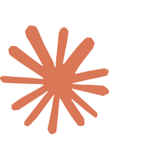
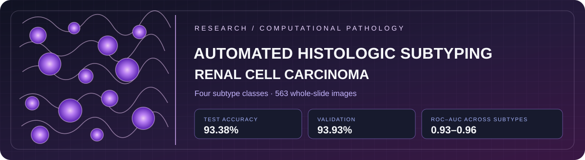
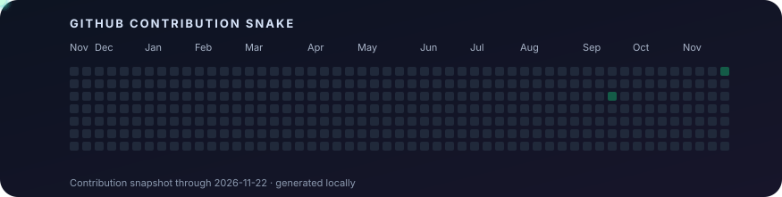

## ⌘ Tools & technologies

<b>AI coding tools</b>

<table width="100%">
  <tr>
    <td width="25%" align="center"> Claude Code</td>
    <td width="25%" align="center"> GitHub Copilot</td>
    <td width="25%" align="center"> OpenAI Codex</td>
    <td width="25%" align="center"> Gemini</td>
  </tr>
</table>

<b>Languages & application development</b>

<table width="100%">
  <tr>
    <td width="25%" align="center"> Python</td>
    <td width="25%" align="center"> C</td>
    <td width="25%" align="center"> C++</td>
    <td width="25%" align="center"> JavaScript</td>
  </tr>
  <tr>
    <td width="25%" align="center"> FastAPI</td>
    <td width="25%" align="center"> React</td>
    <td width="25%" align="center"> Spring Boot</td>
    <td width="25%" align="center">SQL · REST APIs</td>
  </tr>
</table>

<b>AI, machine learning & research</b>

<table width="100%">
  <tr>
    <td width="16%" align="center"> TensorFlow</td>
    <td width="16%" align="center"> Keras</td>
    <td width="16%" align="center"> PyTorch</td>
    <td width="16%" align="center"> Transformers · Hugging Face</td>
    <td width="16%" align="center"> LangChain</td>
    <td width="16%" align="center"> scikit-learn</td>
  </tr>
</table>

<b>Cloud, DevOps & source control</b>

<table width="100%">
  <tr>
    <td width="16%" align="center"> Azure</td>
    <td width="16%" align="center"> Terraform</td>
    <td width="16%" align="center"> Azure DevOps</td>
    <td width="16%" align="center"> Git</td>
    <td width="16%" align="center"> GitHub</td>
    <td width="16%" align="center"> GitHub Actions · CI/CD</td>
  </tr>
</table>

<b>Data, development & observability</b>

<table width="100%">
  <tr>
    <td width="25%" align="center"> Jupyter</td>
    <td width="25%" align="center"> Google Colab</td>
    <td width="25%" align="center"> Hadoop</td>
    <td width="25%" align="center"> PySpark</td>
  </tr>
  <tr>
    <td width="25%" align="center"> OpenTelemetry</td>
    <td width="25%" align="center"> Elastic</td>
    <td width="25%" align="center"> Linux</td>
    <td width="25%" align="center"> VS Code</td>
  </tr>
</table>

Azure services: Functions · SQL · Cosmos DB · Service Bus · AI Search · Blob Storage · Data Factory · Synapse · Monitor · Application Insights

Analytics & data: Power BI · Analysis Services · Delta Lake · ETL · KQL · Bruno

Methods: Random Forest · GAN &nbsp; | &nbsp; Semantic web: RDF/XML · SPARQL &nbsp; | &nbsp; Models & parsing: Llama 3 · PyPDF2 &nbsp; | &nbsp; APIs & agent systems: REST · MCP · semantic search · agent evaluation · skills · context engineering

## ◈ 3D project map

## ✦ Selected projects

<table width="100%">
  <tr>
    <td width="50%" valign="top">
      
      <h3>Personalised Educational Chatbot</h3>
      
A responsive learning assistant with companion video-to-text and text-to-speech experiments.

      
Python · NLP · TensorFlow · Keras

    </td>
    <td width="50%" valign="top">
      
      <h3>Smart Stadium</h3>
      
A machine-learning mini-project exploring connected stadium systems.

      
Python · scikit-learn · Random Forest · GAN

    </td>
  </tr>
  <tr>
    <td colspan="2" valign="top">
      
      <h3>Renal Cell Carcinoma Subtyping · Research</h3>
      
Computational pathology research across four subtypes and 563 whole-slide images.

      
<b>93.38% test accuracy</b> · 93.93% validation · ROC-AUC 0.93–0.96

      
Research prototype · not a clinical diagnostic tool

    </td>
  </tr>
</table>

## ◈ Contribution snake

Personal projects · experiments · research
 
Contribution image is a local calendar snapshot through November 22, 2026.
 
Reusable components: <a href="https://github.com/Jay260802/github-profile-kit">GitHub Profile Kit</a> · <a href="https://github.com/Jay260802/github-profile-kit/blob/main/tools/analyze_profile.py">Profile analyzer</a> · <a href="https://github.com/Jay260802/github-profile-kit/blob/main/tools/generate_snake.py">Snake generator</a>

