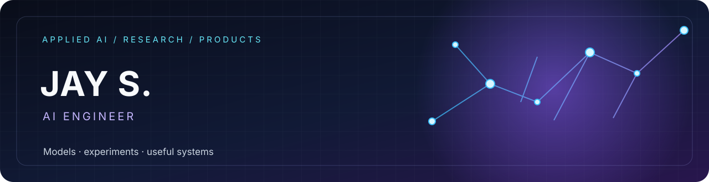
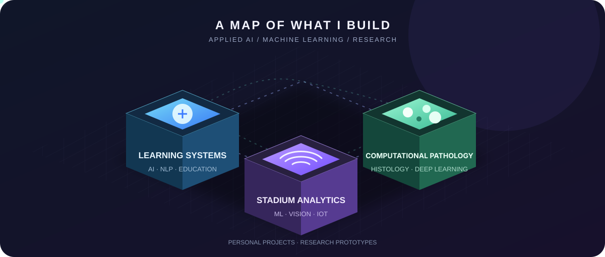
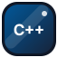

### Turning models and experiments into useful systems.

## ✦ Selected projects

<table>
  <tr>
    <td width="50%" valign="top">
      
      <h3>01 · Personalised Educational Chatbot</h3>
      
A responsive learning assistant, with related video-to-text and text-to-speech notebook experiments.

      
Python · NLP · TensorFlow · Keras

    </td>
    <td width="50%" valign="top">
      
      <h3>02 · Smart Stadium</h3>
      
A mini-project exploring machine-learning approaches for connected stadium systems.

      
Python · scikit-learn · Random Forest · GAN

    </td>
  </tr>
  <tr>
    <td colspan="2" valign="top">
      
      <h3>03 · Automated Histologic Subtyping of Renal Cell Carcinoma</h3>
      
Computational-pathology research classifying four renal-cell carcinoma subtypes from 563 whole-slide images.

      
<b>93.38% test accuracy</b> · 93.93% validation accuracy · ROC-AUC 0.93–0.96 across the four subtypes

      
Research prototype · not a clinical diagnostic tool

    </td>
  </tr>
</table>

## ◈ How the projects connect

## ⌘ Toolbox

**AI workbench**

<table>
  <tr>
    <td align="center" width="33%"> Claude</td>
    <td align="center" width="33%"> OpenAI Codex</td>
    <td align="center" width="33%"> Gemini</td>
  </tr>
</table>

 

**Languages & frameworks**

<table>
  <tr>
    <td width="20%" align="center"> Python</td>
    <td width="20%" align="center"> C++</td>
    <td width="20%" align="center"> JavaScript</td>
    <td width="20%" align="center"> React</td>
    <td width="20%" align="center"> Spring Boot</td>
  </tr>
</table>

 

**AI & machine learning**

<table>
  <tr>
    <td width="33%" align="center"> PyTorch</td>
    <td width="33%" align="center"> TensorFlow</td>
    <td width="33%" align="center"> Keras</td>
  </tr>
  <tr>
    <td width="33%" align="center"> Transformers</td>
    <td width="33%" align="center"> LangChain</td>
    <td width="33%" align="center"> scikit-learn</td>
  </tr>
</table>

 

**Research & data tools**

<table>
  <tr>
    <td width="33%" align="center"> Jupyter</td>
    <td width="33%" align="center"> Google Colab</td>
    <td width="33%" align="center"> Hadoop</td>
  </tr>
  <tr>
    <td width="33%" align="center"> RDF · XML</td>
    <td width="33%" align="center"> SPARQL</td>
    <td width="33%" align="center"> Llama 3</td>
  </tr>
  <tr>
    <td width="33%" align="center"> Random Forest</td>
    <td width="33%" align="center"> GAN</td>
    <td width="33%" align="center"> PyPDF2</td>
  </tr>
</table>

  
<b>Educational Chatbot archive note</b>

   
  
The résumé version lists TensorFlow/Keras. The archived notebooks also contain PyTorch LSTM/GRU, Llama 3, Hugging Face Transformers, and LangChain experiments. These technologies span the project archive and should not be read as a claim that every component shipped in one chatbot build.

Personal projects · experiments · research
 
Profile components: <a href="https://github.com/Jay260802/github-profile-kit">github-profile-kit</a>

