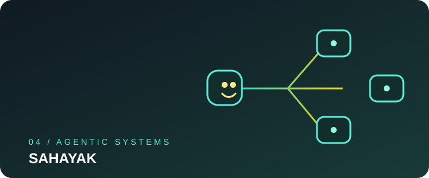

### Building thoughtful AI systems, experiments, and tools.

 

## ◈ Languages & build toolkit

 

`Applied AI` · `Machine Learning` · `NLP` · `Agentic AI` · `Research`

## ✦ Selected projects

<table>
  <tr>
    <td width="50%" valign="top">
      
      
<b>01 / Personalised Educational Chatbot</b>

      
A learning-assistant project with conversational and audio/video notebook experiments.

      
Project archive identified · repository and framework details under review

    </td>
    <td width="50%" valign="top">
      
      
<b>02 / Smart Stadium</b>

      
A stadium-focused mini project exploring connected-venue and machine-learning ideas.

      
Project archive identified · notebook and dataset review pending

    </td>
  </tr>
  <tr>
    <td width="50%" valign="top">
      
      
<b>03 / Renal Cancer Research</b>

      
Research into automated histologic subtyping of renal cell carcinoma.

      
Research archive identified · publication and data-sharing review pending

    </td>
    <td width="50%" valign="top">
      
      
<b>04 / Sahayak</b>

      
An agentic-AI hackathon project candidate from the project archive.

      
Confirm code, contribution, and public sharing before featuring

    </td>
  </tr>
</table>

  
<b>More projects to revisit</b>

   
  Cryptography App · Hadoop Stock Analysis · JAVSS · Leaf of Faith
    
  These stay out of the featured area until code, ownership, and sharing permissions are reviewed. Company material is excluded.

## ⌘ Research notes

  
<b>Computational pathology</b>

   
  
Research summary, verified methodology, and approved paper links can be added here after reviewing the source materials and data permissions.

## ◌ Current exploration

`Multimodal learning` · `AI agents` · `Useful developer tools`

## ⌁ GitHub activity

 

 

 

 

<!-- A 3D contribution calendar can be added after enabling its GitHub Actions workflow. -->

Personal projects · experiments · research

