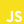
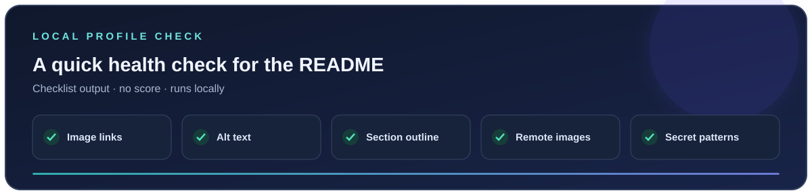
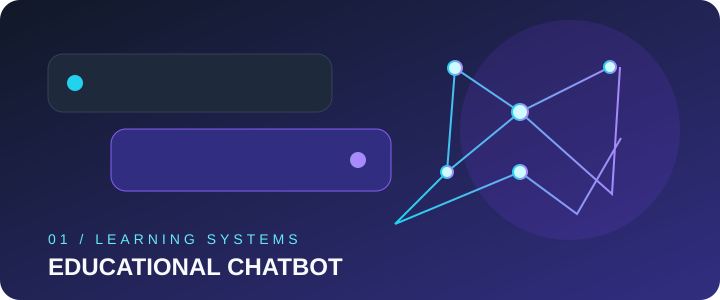
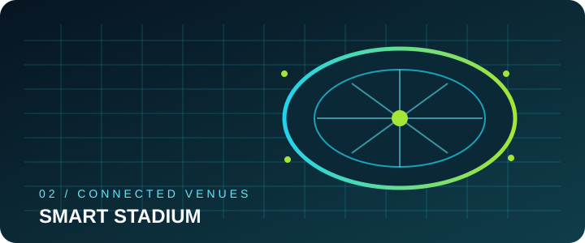

## ⌘ Tools & technologies

<table width="100%">
  <tr><th colspan="3" align="left">AI workbench</th></tr>
  <tr>
    <td width="33%" align="center"> Claude</td>
    <td width="33%" align="center"> Codex</td>
    <td width="33%" align="center"> Gemini</td>
  </tr>
  <tr><th colspan="6" align="left">Languages & frameworks</th></tr>
  <tr>
    <td width="16%" align="center"> Python</td>
    <td width="16%" align="center"> C++</td>
    <td width="16%" align="center"> JavaScript</td>
    <td width="16%" align="center"> React</td>
    <td width="16%" align="center"> Spring Boot</td>
    <td width="16%" align="center"> Hadoop</td>
  </tr>
  <tr><th colspan="6" align="left">AI, machine learning & research</th></tr>
  <tr>
    <td width="16%" align="center"> TensorFlow</td>
    <td width="16%" align="center"> Keras</td>
    <td width="16%" align="center"> PyTorch</td>
    <td width="16%" align="center"> Transformers · Hugging Face</td>
    <td width="16%" align="center"> LangChain</td>
    <td width="16%" align="center"> scikit-learn</td>
  </tr>
  <tr>
    <td width="16%" align="center"> Jupyter</td>
    <td width="16%" align="center"> Google Colab</td>
    <td colspan="4" align="left">Methods & formats: Random Forest · GAN · RDF/XML · SPARQL · Llama 3 · PyPDF2</td>
  </tr>
</table>

## ◈ Profile analyzer

A local checklist checks structure, image paths, alt text, remote image dependencies, and credential-shaped strings. It does not assign a score or run as a live dashboard.

## ◈ 3D project map

## ✦ Selected projects

<table width="100%">
  <tr>
    <td width="50%" valign="top">
      
      <h3>Personalised Educational Chatbot</h3>
      
A responsive learning assistant with companion video-to-text and text-to-speech experiments.

      
Python · NLP · TensorFlow · Keras

    </td>
    <td width="50%" valign="top">
      
      <h3>Smart Stadium</h3>
      
A machine-learning mini-project exploring connected stadium systems.

      
Python · scikit-learn · Random Forest · GAN

    </td>
  </tr>
  <tr>
    <td colspan="2" valign="top">
      
      <h3>Renal Cell Carcinoma Subtyping · Research</h3>
      
Computational pathology research across four subtypes and 563 whole-slide images.

      
<b>93.38% test accuracy</b> · 93.93% validation · ROC-AUC 0.93–0.96

      
Research prototype · not a clinical diagnostic tool

    </td>
  </tr>
</table>

Personal projects · experiments · research
 
Reusable components: <a href="https://github.com/Jay260802/github-profile-kit">GitHub Profile Kit</a> · <a href="https://github.com/Jay260802/github-profile-kit/blob/main/tools/analyze_profile.py">Analyzer source</a>

